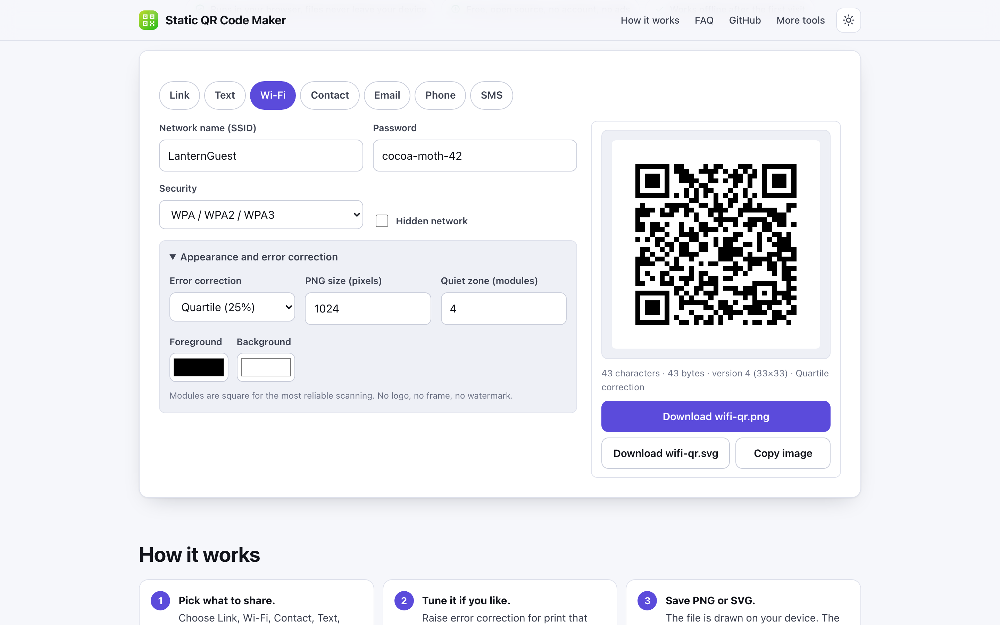
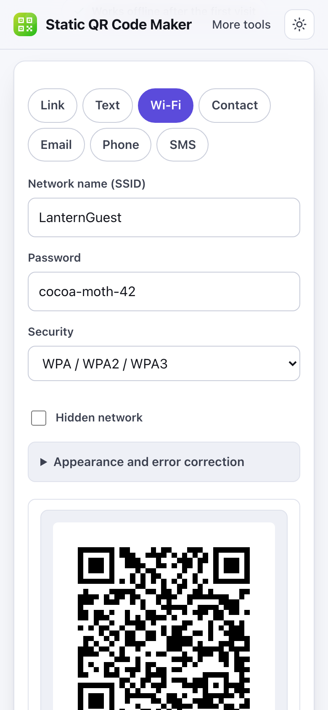

# Static QR Code Maker

> Make QR codes for links, Wi-Fi, text and contacts in your browser, saved as PNG or SVG that never expire.

**🌐 Use it now: [turhe123.github.io/qr-code-maker-local](https://turhe123.github.io/qr-code-maker-local/)** · free · open source · runs in your browser · works offline

  

## Why

Static QR Code Maker is a free, open-source alternative to tools like QR Code Generator Pro and QR Code Monkey, where dynamic QR codes expire unless you pay a monthly subscription, sign-up is required, trial codes stop working, and scans go through tracking redirects. Here the data is encoded directly in the code, so it works forever. Your files never leave the device, there is no account, no ads and no limits, it works offline, and it can be installed as an app.

## Screenshots

<p align="center"></p>

<p align="center"><em>Static QR Code Maker in the browser, light theme</em></p>

<p align="center"></p>

<p align="center"><em>Static QR Code Maker on a phone</em></p>

## Features

- Seven content types: link, text, Wi-Fi network, contact card, email, phone number and SMS.
- Live preview that redraws as you type; no button to press, and every field is reachable by keyboard.
- Wi-Fi codes with SSID, password, security type (WPA/WPA2/WPA3, WEP or open) and a hidden-network flag, using the standard `WIFI:` format with special characters escaped.
- Contact cards in vCard 3.0 format (name, phone, email, organisation) with commas and semicolons escaped.
- Email (`mailto:` with optional subject and message), phone (`tel:`) and SMS (`SMSTO:`) payloads. Bare domains typed as links get `https://` added.
- Error correction levels Low (7%), Medium (15%, default), Quartile (25%) and High (30%).
- Options for PNG size (64 to 4096 px), quiet zone (0 to 16 modules) and foreground and background colours. Modules are square only; there is no logo, frame or watermark.
- Warnings for low contrast (under 3:1), a foreground lighter than the background, sizes under 128 px, a small quiet zone and content close to the capacity limit.
- Readout of character count, byte count, QR version and module grid size.
- Clear error messages for empty input and for content that is too long for the chosen error correction level.
- Text is encoded as UTF-8, so emoji and non-Latin scripts work.
- Crisp output: PNG drawn at whole pixels per module, and a compact SVG built from merged runs of dark modules in a single path.
- Download PNG or SVG (named `qr-code.*`, or after the type such as `wifi-qr.*`), plus a Copy image button where the browser supports it.
- The PNG is also shown as an image so it can be long-pressed and saved on mobile Safari.
- Light and dark themes, a layout that works at 390 px wide, and an installable offline-ready PWA.

**Formats and limits**

- Input: text typed or pasted into the form fields; nothing is uploaded or read from files.
- Output: PNG at the chosen size (raised automatically if every module would not fit) and SVG.
- Capacity: up to 2,953 bytes at Low, 2,331 at Medium, 1,663 at Quartile and 1,273 at High error correction. Emoji and non-Latin letters take 2 to 4 bytes each.
- Static codes cannot be edited after printing; make a new one if the content changes.

## How to use

1. Choose what the code should contain: Link, Text, Wi-Fi, Contact, Email, Phone or SMS.
2. Fill in the fields. The QR code updates as you type, and the readout shows its size and version.
3. Optionally open "Appearance and error correction" to raise error correction for print, set size and quiet zone, or change colours. Heed any contrast warning.
4. Press Download PNG or Download SVG, or Copy image. On a phone, long-press the code to save it.

## Privacy

- Nothing is uploaded. The code is computed in your browser and what you type stays on your device.
- No cookies are set.
- Page views are counted anonymously with [GoatCounter](https://www.goatcounter.com/), which is cookieless and open source.
- After the first visit a service worker caches the page so it works offline.

## Run it locally

```sh
git clone https://github.com/turhe123/qr-code-maker-local
cd qr-code-maker-local
python3 -m http.server 4173
```

Then open http://127.0.0.1:4173/. There is no build step.

## Tests

```sh
npm i -D @playwright/test && npx playwright install chromium
npx playwright test
```

## Third-party code

- [qrcode-generator](https://github.com/kazuhikoarase/qrcode-generator) 1.4.4, MIT license (`vendor/qrcode-generator/`).

## Built with AI

Static QR Code Maker was written by [Claude Code](https://claude.com/claude-code) inside an automated pipeline, from a plain-English spec. No code or assets from any commercial product were used; it is a clean-room implementation of a feature set, not a copy.

What that means in practice:

- The full source is in this repo under the MIT license. Read it before you trust it with your files.
- Everything runs in your browser. It makes no network requests except an anonymous, cookieless page-view count (GoatCounter); your files never leave the device.
- The page is tested headless in Chromium (Playwright) before every release, but it has had less human review than hand-written software. Bug reports and pull requests are welcome.

## Support ❤️

If this saved you a subscription, you can say thanks on [Ko-fi](https://ko-fi.com/leodavidai).

## More free web tools

See the collection at [turhe123.github.io/web-tools](https://turhe123.github.io/web-tools/).

Also: [free, open-source Mac apps](https://turhe123.github.io/mac-apps/) built the same way, native Swift, no accounts, no telemetry.

## License

MIT © Or Davidai Bachar
